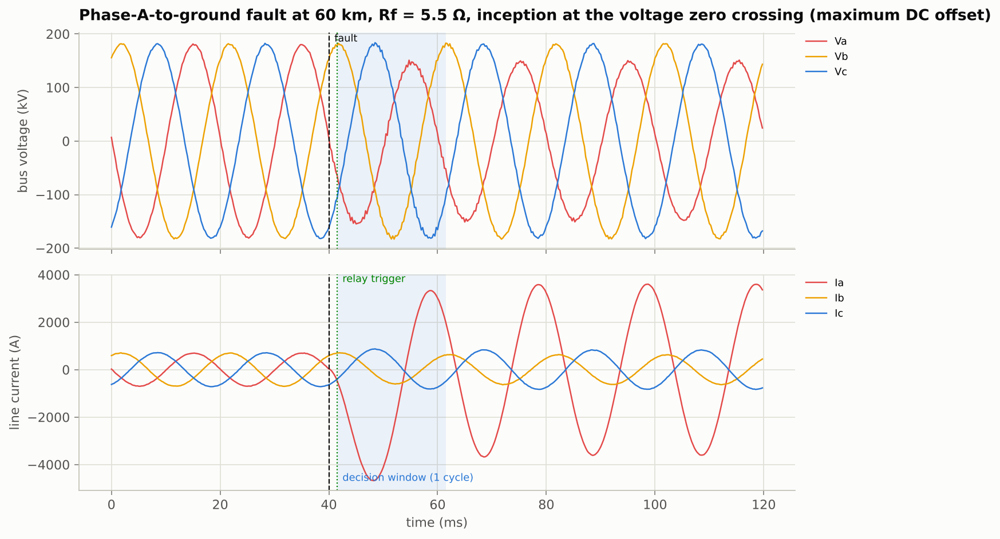
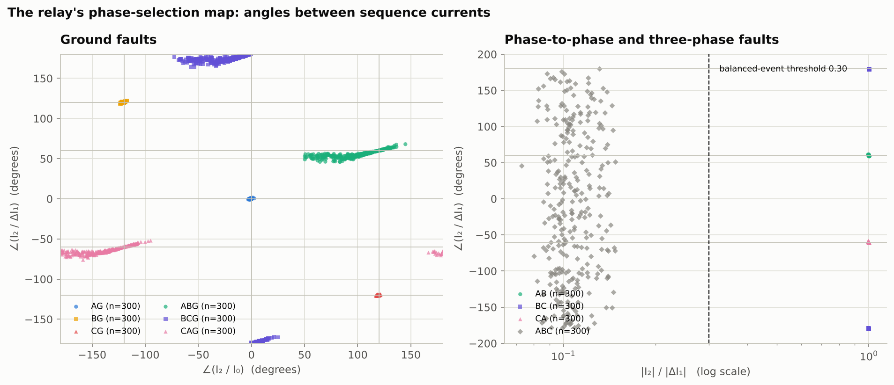
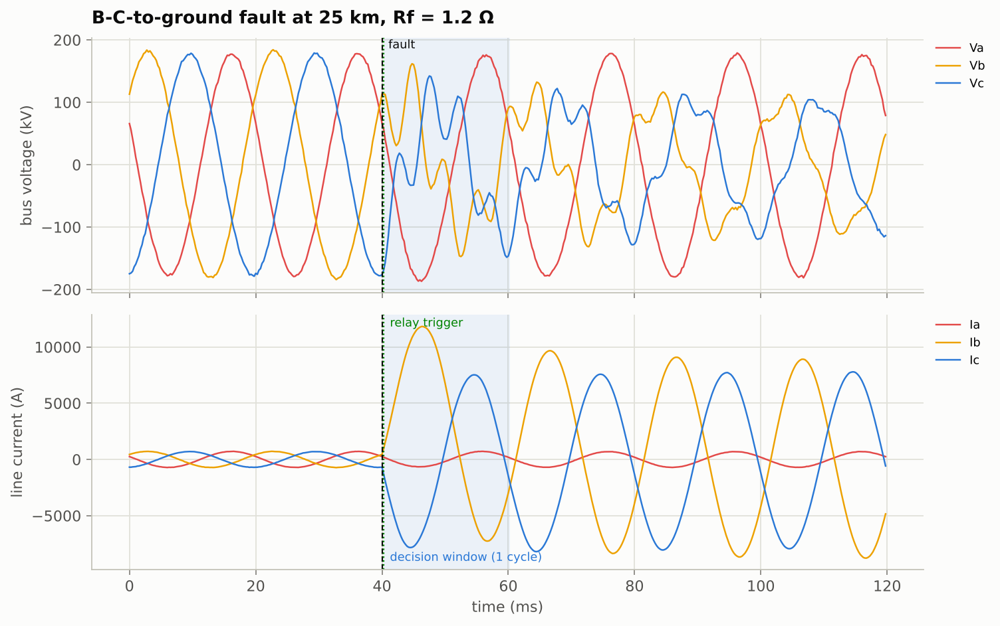
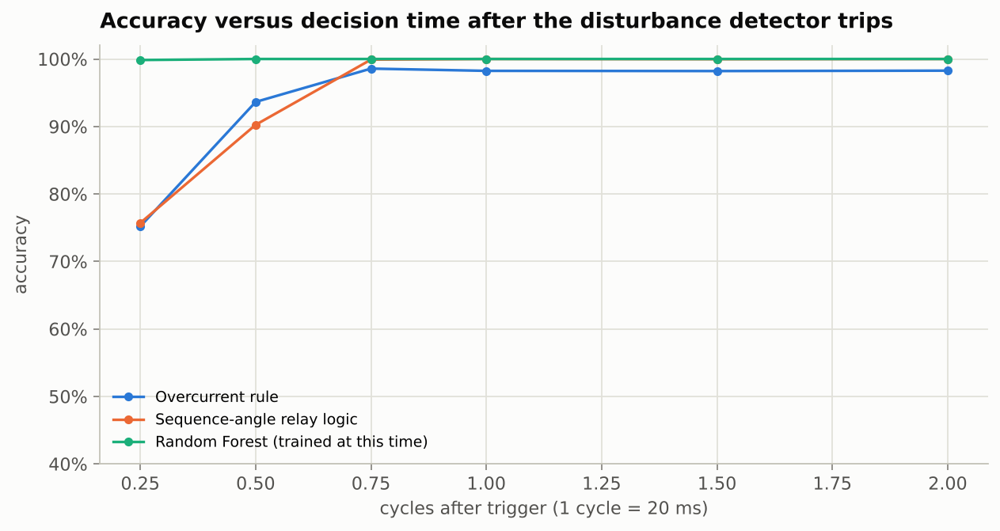
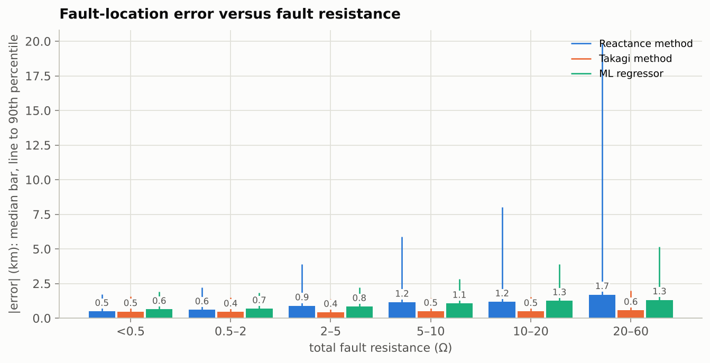

# Transmission-Line Fault Detection, Classification and Location

**A numerical relay built from first principles — disturbance detector, full-cycle DFT phasors, symmetrical
components, phase-selection logic and impedance-based fault location — compared with machine learning on
6,600 + 3,300 + 2,200 events (faults and load switchings) simulated from the circuit equations of a 220 kV,
100 km line, with a Streamlit app to create any fault and watch the relay decide.**

> **In one sentence:** when a transmission line faults, the protection relay has about one cycle (20 ms) to
> decide *that* there is a fault, *which* of the 10 fault types it is (A-G, B-C, A-B-G, A-B-C, …) and *where*
> on the line it is, from nothing but the three voltages and three currents at one end. This project builds
> that relay the way textbooks and real numerical relays do it, builds a physics simulator to test it on
> thousands of faults it has never seen, and asks the honest question: does machine learning actually add
> anything?

<p align="center">
  
</p>

---

## Results at a glance (3,300 test events, 11 classes, decision 1 cycle after the trigger)

Every test event is a *new* fault: random location (2–98 km), arc and ground resistance (0.01–5 Ω and
0.1–50 Ω), inception angle, load angle, source strengths and voltages — seen through instrument transformers
with ±2 % ratio errors and 40 dB measurement noise. "No fault" events are either nothing happening or a
balanced load switching of 20–150 MW, which a relay must *not* trip on.

| Method | needs training data? | accuracy (11 classes) | fault / no-fault | missed faults | false trips | unseen system* |
|---|---|---|---|---|---|---|
| Overcurrent rule (which phase currents jumped) | no | 98.2 % | 98.2 % | 0 | 58 | 98.0 % |
| **Sequence-angle relay logic** (∠ I₂/ΔI₁, residual current, impedance zone) | no | **100 %** | **100 %** | **0** | **0** | **100 %** |
| k-Nearest Neighbours | yes | 99.8 % | 100 % | 0 | 0 | 99.7 % |
| Neural Network (64-64) | yes | 99.9 % | 100 % | 0 | 0 | 99.6 % |
| Random Forest | yes | **100 %** | 100 % | 0 | 0 | **100 %** |
| Gradient Boosting | yes | **100 %** | 100 % | 0 | 0 | **100 %** |

\* 2,200 events on a system the models never saw: 150 km line, line constants changed by 15 %, different
source strengths.

| Fault location (3,000 faulted test events, window 3 cycles after the trigger) | MAE | median | 90th pct. | bolted faults (R_f < 0.5 Ω), median |
|---|---|---|---|---|
| Reactance method (Im Z_loop / X₁) | 1.71 km | 0.70 km | 3.60 km | 0.49 km |
| **Takagi method** (superimposed current) | **0.68 km** | **0.47 km** | **1.55 km** | 0.48 km |
| ML regressor (gradient boosting on the relay features) | 1.11 km | 0.79 km | 2.45 km | 0.63 km |

* **Textbook relay logic gets every one of the 3,300 test events right, and every one of the 2,200 events
  on a different line with the same settings, with no training at all** (one error in the 6,600 training
  events) — because the physics of a fault is encoded in the angles between the sequence currents: the angle between
  the negative-sequence current and the superimposed positive-sequence current points at the faulted phase
  (AG 0°, BG +120°, CG −120°) or phase pair (BC 180°, AB +60°, CA −60°), residual current tells a
  line-to-line fault from a double-line-to-ground one, and the loop impedance tells a three-phase fault from
  a load change. Its settings are derived from the measurement model and the line, not fitted.
* **Machine learning matches it but cannot beat it**: Random Forest and Gradient Boosting also reach 100 %,
  on the unseen system too, because the features are per-unit relay quantities, not raw samples — the models
  learn *relay logic*, not *this line*; kNN and the MLP stay slightly behind (99.8 %, 99.9 %).
* **Speed is where learning helps:** the relay logic is 76 % correct a quarter cycle after the trigger, 90 %
  at half a cycle (10 ms), 99.9 % at three-quarters and 100 % at one cycle (3,299 of 3,300 at 1.5 cycles, all
  at 2); a Random Forest trained for the early window is 99.9 % at a quarter cycle and 100 % from half a
  cycle. All methods hold at or above 98 % down to 30 dB SNR, the relay logic (99.5 %) and the Random Forest
  (99.3 %) still above 99 % at 25 dB; at 20 dB (noise RMS 10 % of the load current) all of them break down
  together, to 68–74 % — the limit is the measurement, not the algorithm.
* **Fault location:** the reactance method is exact for bolted faults but over/under-reaches with fault
  resistance plus remote infeed; Takagi's projection on the superimposed current removes most of that
  (MAE 0.68 km on a 100 km line, i.e. 0.7 %). The ML regressor is *worse* than Takagi — a plain physical
  method with the right quantity beats a learned one.

Full tables, confusion matrices, per-class scores and all figures: [`reports/results.md`](reports/results.md).

<p align="center">
  
</p>

---

## How it works

```
 physics simulator                relay (src/tlf)                                           decisions
 ───────────────────────────      ────────────────────────────────────────────────────    ─────────────────
 Es─[Zs]─S══(d km)══F══(L−d)══R─[Zr]─Er    v(t), i(t) at S, 4 kHz                        fault / no fault
          │ relay      │ fault     ──▶ 1. delta-current disturbance detector  (trigger)
          └ measures   └ network   ──▶ 2. full-cycle DFT phasors, pre-fault and 1 cycle after      fault type
 lumped π-line, coupled phases     ──▶ 3. symmetrical components I0, I1, I2, ΔI1, V0, V1, V2        (11 classes)
 exact expm integration            ──▶ 4. 58 per-unit features (sequence ratios and angles,
 random faults + operating points        superimposed currents, six loop impedances)               distance to
                                   ──▶ 5. rules (overcurrent, sequence-angle) | ML (kNN, NN, RF, GB)  the fault (km)
                                   ──▶ 6. location: reactance | Takagi | ML regressor (3-cycle window)
```

1. **Physics simulator** (`src/tlf/simulate.py`) — a 220 kV, 50 Hz, 100 km single-circuit line between two
   sources (5,000 and 3,000 MVA short-circuit level) with a load angle that sets the power flow. Each line
   segment is a lumped π-section in the *phase domain* (3×3 R, L, C matrices with mutual coupling, built from
   the positive- and zero-sequence constants). The fault is a resistance network at the chosen point: each
   faulted phase through an arc resistance to a common fault node, and that node through a ground resistance
   to earth. Between switching instants the circuit is linear and time-invariant, so it is integrated
   **exactly** with the matrix exponential (`scipy.linalg.expm`), from a closed-form steady state — no
   numerical damping, no start-up transient. The DC offset that depends on the inception angle, the current
   fed from the remote end, the charging current of the line: all of it falls out of the circuit equations.
   The simulator is checked against the hand formulas: three-phase, single-line-to-ground
   (I = 3E/(Z₁+Z₂+Z₀)) and line-to-line fault currents agree within 1 %.
2. **Relay signal processing** (`src/tlf/dsp.py`, `features.py`) — a *delta* disturbance detector (every
   sample compared with the sample one cycle earlier; three consecutive samples above 15 % of nominal
   current trip it), full-cycle DFT phasors of the window ending one cycle after the trigger, the Fortescue
   transform, superimposed quantities (post-fault minus pre-fault), and the six loop impedances a distance
   relay forms (V_a/(I_a + k₀·3I₀) for ground loops, (V_a−V_b)/(I_a−I_b) for phase loops). Everything is in
   per unit, so the 58-element feature vector describes *the event*, not the line.
3. **Two rule-based classifiers** (`src/tlf/classical.py`) — the overcurrent intuition (phases whose current
   jumped are faulted; residual current means ground) and the phase-selection logic of numerical distance
   relays (six angular sectors of ∠(I₂/ΔI₁), residual-current test, impedance-zone test for ABC vs load
   switching). The settings are derived the way a relay engineer derives them — six 60°-wide sectors
   (nearest centre wins), a ground pick-up of 1.5 × the spurious residual that ±2 % CT ratio errors can
   produce, a zone reach of 160 % of the line impedance — and checked for margin on the training events
   only; nothing is fitted.
4. **Four ML classifiers** (`src/tlf/models.py`) — kNN, a 64-64 MLP, a Random Forest and gradient boosting,
   trained on 6,600 events and tested on 3,300 others *and* on 2,200 events from a different line and sources.
5. **Three fault locators** (`src/tlf/locate.py`) — reactance method, Takagi method and a gradient-boosting
   regressor on the 3-cycle features plus the predicted class.
6. **Studies** (`scripts/run_experiments.py`) — decision time (¼ → 2 cycles), measurement noise
   (clean → 20 dB), unseen system, high-resistance faults (> 20 Ω), location error versus fault resistance,
   and a benchmark on the popular Kaggle fault dataset that explains why its "99.9 %" is not a relay result.

### The physics in three figures

| | |
|---|---|
|  | **A fault is a change of circuit.** B-C-to-ground at 25 km: the two faulted phases carry 11–14× the load current, the sound phase A is barely disturbed, and the voltages of B and C drop to 0.57–0.58 pu. The fault instant (dashed), the relay's trigger (dotted, here almost coincident) and its one-cycle decision window are marked. |
|  | **How fast can you decide?** Half a cycle after the trigger the DFT window is still half pre-fault; a Random Forest trained for that window is already 100 % correct, the fixed relay logic 90 % — and 99.9 % a quarter cycle later. One cycle is the usual choice in practice — this is why. |
|  | **Fault resistance is the enemy of one-ended location.** With remote infeed the drop across R_f has a reactive component and the reactance method drifts by kilometres; Takagi's method cancels most of it. |

---

## Demo app

```bash
streamlit run app/streamlit_app.py
```

Choose a fault type, slide the distance, arc and ground resistance, inception angle, load angle and noise,
and watch the relay: trigger time, the decision of every method, the three location estimates, the
waveforms with the decision window, the phasors and the sequence components, and the selector angles that
the rule used.

Command line — simulate an event or run the relay on your own record:

```bash
python scripts/diagnose.py --kind BCG --distance 35 --r-arc 0.3 --r-ground 2 --inception 70
python scripts/diagnose.py --csv my_record.csv --fs 4000        # columns Va,Vb,Vc,Ia,Ib,Ic (instantaneous V and A)
```

```
Disturbance detector : tripped at 40.2 ms
Sequence currents    : |I0| = 1226 A, |I1| = 4623 A, |I2| = 3325 A, angle(I2/dI1) = +173 deg, residual ratio = 0.46

Overcurrent rule            : BCG   (LLG)  OK
Sequence-angle relay logic  : BCG   (LLG)  OK
k-Nearest Neighbours        : BCG   (LLG)  OK
Neural Network              : BCG   (LLG)  OK
Random Forest               : BCG   (LLG)  OK
Gradient Boosting           : BCG   (LLG)  OK

Fault location (3-cycle window), class BCG:
  Reactance method     34.7 km   (true 35.0 km)
  Takagi method        34.9 km   (true 35.0 km)
  ML regressor         35.2 km   (true 35.0 km)
```

---

## Quick start

```bash
git clone https://github.com/MayankGangwal-code/transmission-line-fault-classification.git
cd transmission-line-fault-classification
pip install -r requirements.txt

python scripts/run_experiments.py   # simulates 12,100 events, trains and evaluates everything, writes reports/ (~2 min)
pytest -q                           # 31 tests: simulator vs hand calculation, relay logic, locators, saved data and models
streamlit run app/streamlit_app.py  # interactive demo
```

The generated data (`data/events_*.csv`, 15 MB) and trained models are included, so the app, the CLI and the
notebook work without re-running the experiments. Dependencies: `numpy`, `pandas`, `scipy`, `scikit-learn`,
`matplotlib`, `joblib` (+ `streamlit` for the app).

---

## Data

**All faults are generated by the project's own physics simulator**, and that is deliberate: real relay
records of faults on a line are rare, confidential and never labelled by distance and resistance, and every
public "fault dataset" is itself a simulation (usually MATLAB/Simulink). Writing the simulator means every
assumption is visible and testable (`tests/test_physics.py` checks it against the textbook formulas), and
every parameter can be randomised — which is what makes the generalisation tests meaningful.

| set | events | system | purpose |
|---|---|---|---|
| train | 6,600 (600 per class) | 220 kV, 100 km reference line; random operating point per event | fit the ML models |
| test | 3,300 (300 per class) | same line, new random events | all headline numbers |
| unseen | 2,200 (200 per class) | 150 km line, line constants ±15 %, other source strengths | does it transfer to another line? |

Each row of `data/events_*.csv` is one event: its true parameters (type, distance, resistances, inception
angle, load angle, sources) and the 58 relay features at the 1-cycle decision window. `data/waveforms_sample.npz`
holds one raw waveform record per class. See [`data/README.md`](data/README.md) for the columns and the line data.

**The public Kaggle dataset** (*Electrical fault detection and classification*, 7,861 rows, `data/external/`)
is used for comparison only (not redistributed here; see [`data/README.md`](data/README.md) to download it). Every row is one time sample of a single Simulink run per class — one
location, one resistance, no time column, irregular sampling — so it cannot be processed like a relay does and
cannot test generalisation. Classifying its rows one at a time gives 86.6 % (random split) / 88.2 % (time-block
split) with a Random Forest, not the ~99.9 % that is often reported from leaky splits; an instantaneous sample
is simply an ambiguous description of a fault. Details in `reports/results.md` §6.

---

## Project structure

```
transmission-line-fault-classification/
├── app/streamlit_app.py          interactive demo
├── data/
│   ├── events_train.csv, events_test.csv, events_unseen.csv   event parameters + relay features
│   ├── waveforms_sample.npz      one raw record per class
│   ├── external/classData.csv    the Kaggle dataset (comparison only, download separately)
│   └── README.md
├── docs/
│   ├── interview_prep.md         30-second pitch, 2-minute version, 40 likely questions with answers
│   ├── theory.md                 symmetrical components, fault analysis, relaying and location — cheat-sheet
│   └── resume_bullets.md         ready-to-paste resume lines
├── models/classifiers.joblib, locator.joblib
├── notebooks/fault_relay_walkthrough.ipynb   the whole analysis as one notebook
├── reports/
│   ├── results.md                auto-generated results report
│   ├── metrics.json              every number in this README
│   └── figures/*.png
├── scripts/
│   ├── run_experiments.py        simulate → features → rules + ML → studies → location → figures → report
│   ├── diagnose.py               command-line relay (simulate an event or read a CSV record)
│   └── make_notebook.py
├── src/tlf/
│   ├── __init__.py               the 11 classes and their groups
│   ├── simulate.py               physics simulator (π-line, two sources, fault network, exact expm integration)
│   ├── dsp.py                    DFT phasors, symmetrical components, disturbance detector
│   ├── features.py               the relay's decision quantities (58 features) and loop impedances
│   ├── classical.py              overcurrent rule and sequence-angle relay logic
│   ├── locate.py                 reactance and Takagi fault locators
│   ├── models.py                 scikit-learn classifiers and the location regressor
│   └── evaluate.py, plots.py
├── tests/                        pytest suite (31 tests)
├── requirements.txt, pyproject.toml
└── LICENSE
```

---

## What I learned / limitations

* **The feature, not the model, is the engineering.** Raw samples from the Kaggle set give 87 %; relay
  quantities from a one-cycle window give 100 % with fixed settings. The symmetrical-component angles are
  what make the 11 classes separable — a forest trained on them rediscovers the same logic (its most
  important features are I₂/ΔI₁, I₀/I₁, the residual ratio and cos ∠(I₂/ΔI₁)).
* **Settings come from the measurement model, and a rule fails exactly where the physics says it must.**
  A first version used a 10 % residual pick-up and a current-rise test for three-phase faults and scores
  99.8 % on this test set: six double-line-to-ground faults in the last 10 km of the line through 27–43 Ω of
  ground resistance are reported as line-to-line (most of their zero-sequence current flows in from the
  remote end, so the local residual is only 6.6–9.2 %), and two load switchings of 129 and 141 MW trip the
  current-rise test. Deriving the pick-up from the CT error model (two phases with opposite ±2 % ratio
  errors → 4 % spurious residual → pick-up 6 %) and replacing the current-rise test by the distance-relay
  impedance zone removes all of them; the one error left in 6,600 training events is a CAG fault at 97.7 km
  through 32 Ω whose local residual is 5.7 %. The
  overcurrent rule's 58 false trips are large load switchings (77–148 MW): "the current jumped" is not a
  fault criterion; the sequence rule survives them because a load change has no negative-sequence current
  and leaves the loop impedance far outside the line.
* **Training on the physics transfers; training on one line would not.** Features in per unit of nominal
  voltage, a current base and the line impedance let models trained on a 100 km line keep 100 % on a 150 km
  line with different constants — the relay-engineering equivalent of feature normalisation.
* **The DC offset matters for location, not for classification.** A full-cycle DFT rejects harmonics and
  steady DC but not a *decaying* DC component; at one cycle it biases the reactance by up to about 10 % (a
  bolted 60 km fault reads anywhere from 53 to 65 km depending on the inception angle, 59–61 km at three
  cycles), which is why location uses the window three cycles after the trigger (a relay would also filter it
  with a mimic circuit) while phase selection does not care — a 10 % phasor error does not move a 60° sector.
* **Not covered:** CT saturation, series-compensated or double-circuit (mutually coupled) lines, evolving
  and cross-country faults, power swings and out-of-step blocking, distributed-parameter (travelling-wave)
  line models, and two-ended or travelling-wave location — each a well-known next step. The remote end is
  modelled as a source behind an impedance, so remote infeed is always present.

---

## References

* J. L. Blackburn, T. J. Domin, *Protective Relaying: Principles and Applications*, 4th ed., CRC Press, 2014.
* A. G. Phadke, J. S. Thorp, *Computer Relaying for Power Systems*, 2nd ed., Wiley, 2009 (full-cycle DFT,
  symmetrical-component phase selection).
* C. L. Fortescue, "Method of symmetrical co-ordinates applied to the solution of polyphase networks",
  *Trans. AIEE* 37 (1918).
* T. Takagi, Y. Yamakoshi, M. Yamaura, R. Kondow, T. Matsushima, "Development of a new type fault locator
  using the one-terminal voltage and current data", *IEEE Trans. Power Apparatus and Systems* PAS-101(8), 1982.
* IEEE Std C37.114-2014, *IEEE Guide for Determining Fault Location on AC Transmission and Distribution Lines*.
* G. Ziegler, *Numerical Distance Protection: Principles and Applications*, 4th ed., Siemens / Publicis, 2011.
* Kaggle dataset: E. S. Prakash, "Electrical fault detection and classification" (Simulink export), used
  via the GitHub mirror `Joiyad/fault-detection-and-classification-using-ML`.

---

**Author:** Mayank Gangwal — B.Tech Electrical Engineering, NSUT Delhi ·
[GitHub](https://github.com/MayankGangwal-code) · mayank.ug23@nsut.ac.in · MIT licence.
