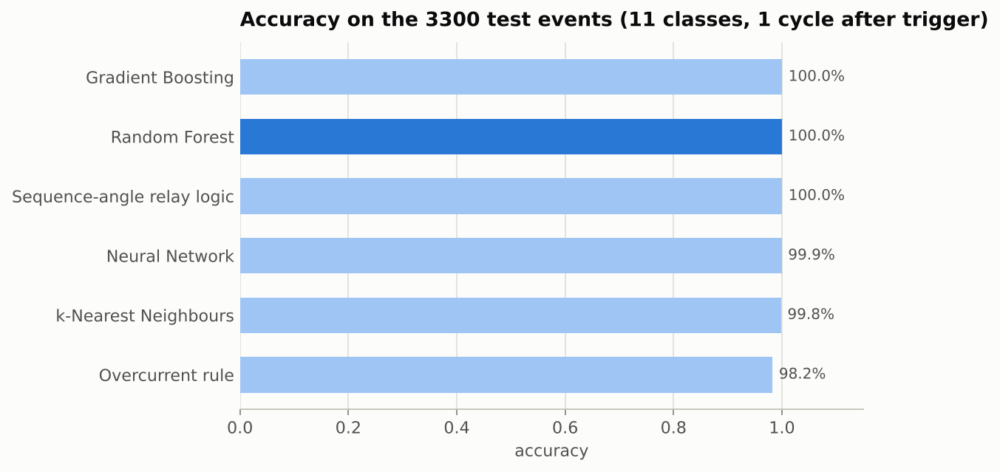
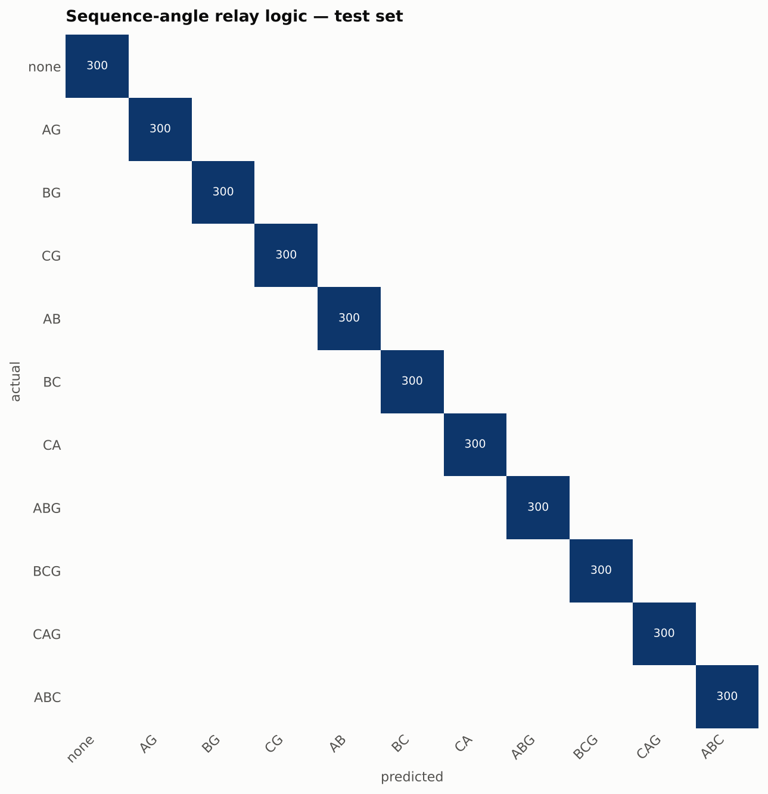
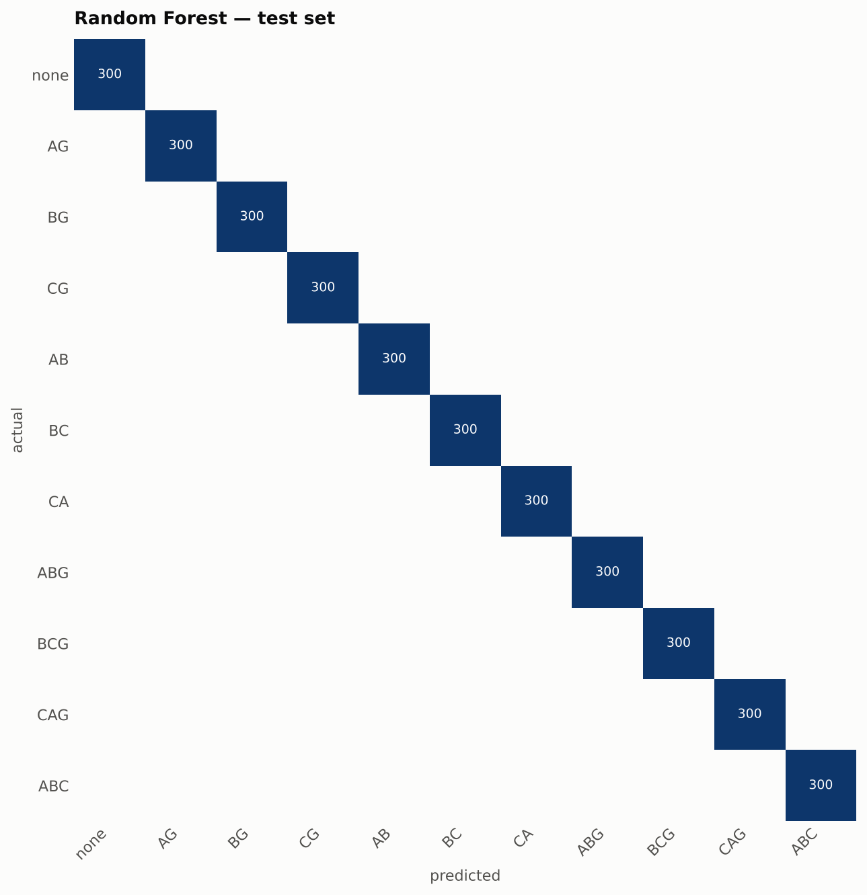
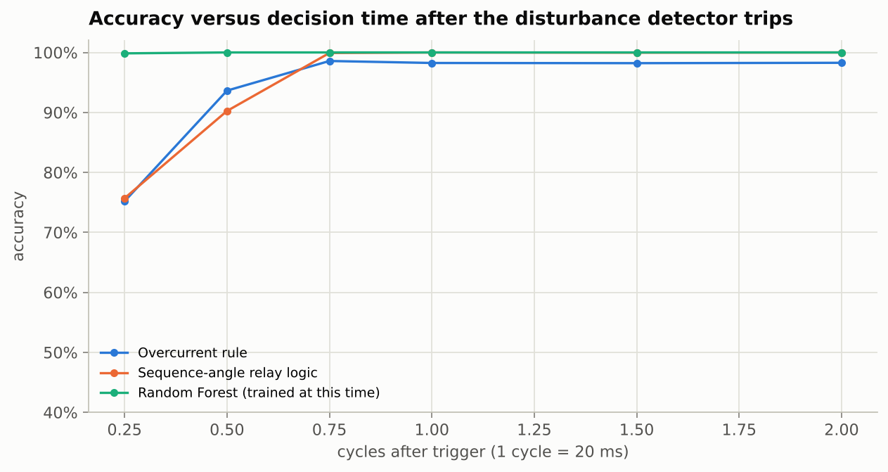
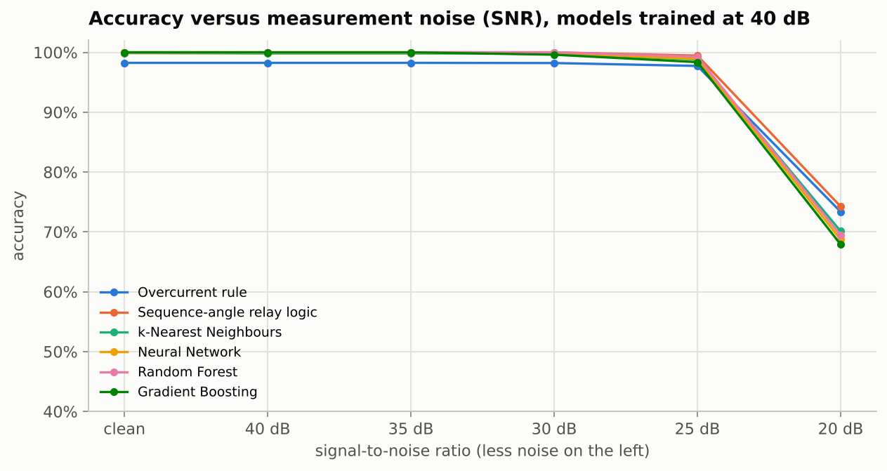
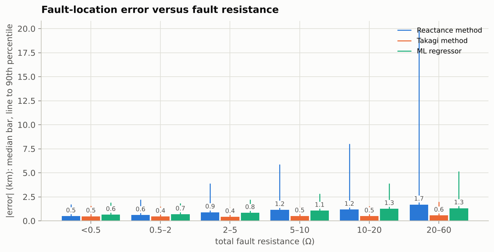
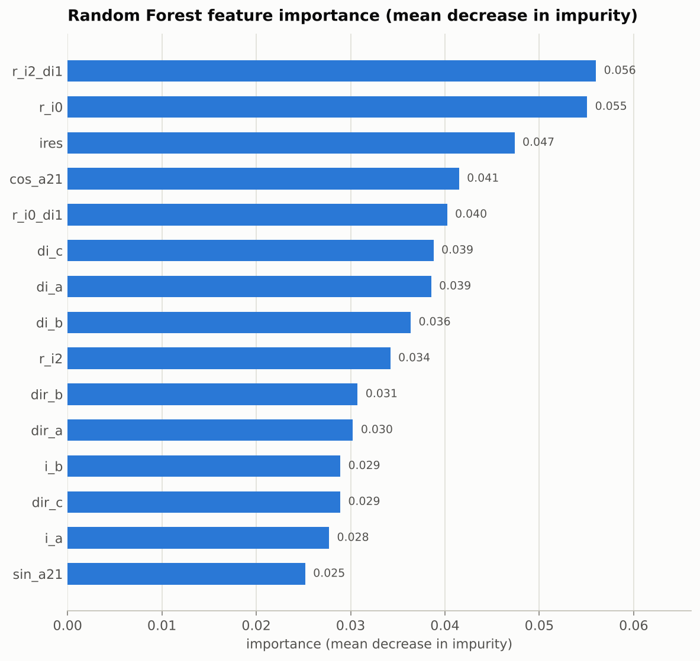
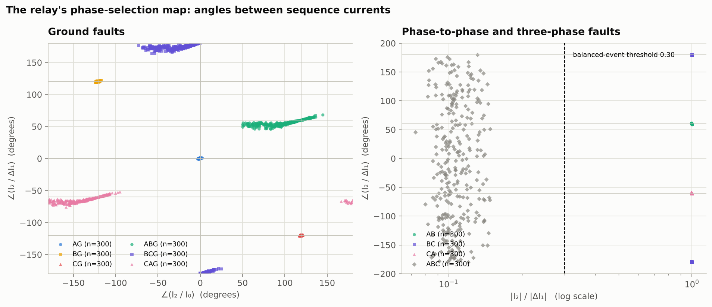
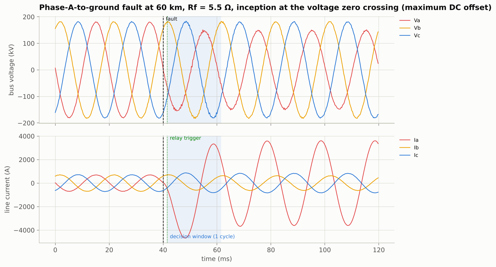
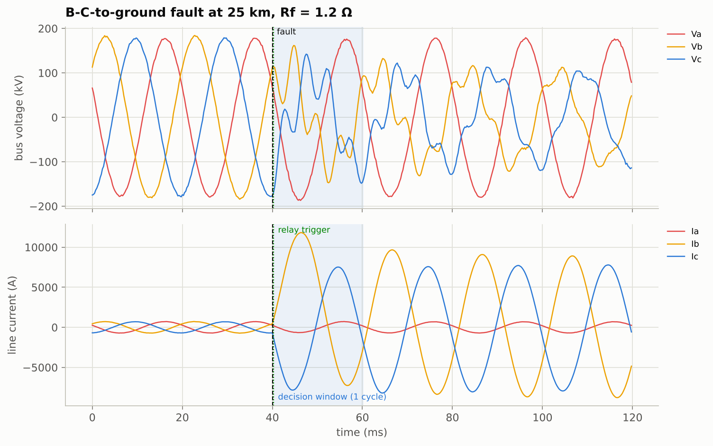

# Results

Generated by `scripts/run_experiments.py` (random_state = 42, runtime 125.6 s).

**Data.** 6600 training and 3300 test events simulated on a 220 kV, 100 km, 50 Hz line between two
sources (600 / 300 per class, 11 classes: no fault or balanced load switching, AG, BG, CG, AB, BC, CA, ABG,
BCG, CAG, ABC). Every event has its own random fault location (2–98 km), arc resistance (0.01–5 Ω), ground
resistance (0.1–50 Ω), inception angle (0–360°), load angle (5–30°), source strengths (±30 %) and source
voltages. A third set of 2200 events uses an **unseen system** (150 km line, line constants changed by 15 %,
different source strengths). The relay sees the signals through instrument transformers with random
per-phase ratio errors of ±2 % and with white measurement noise at 40 dB SNR, sampled at 4000 Hz
(80 samples per cycle).

**Relay processing.** Delta-current disturbance detector → full-cycle DFT phasors of the window that ends
1 cycle after the trigger → symmetrical components, superimposed quantities, loop impedances
(58 features). Fault location uses the window ending 3 cycles after the trigger, when the DC
offset has decayed.

## 1. Classification, 1 cycle after the trigger (3300 test events)

| Method | accuracy (11 classes) | macro-F1 | fault-type accuracy (LG/LL/LLG/LLL/none) | fault vs no-fault | missed faults | false trips |
|---|---|---|---|---|---|---|
| Overcurrent rule | 98.2 % | 0.982 | 98.2 % | 98.2 % | 0 | 58 |
| Sequence-angle relay logic | 100.0 % | 1.000 | 100.0 % | 100.0 % | 0 | 0 |
| k-Nearest Neighbours | 99.8 % | 0.998 | 99.8 % | 100.0 % | 0 | 0 |
| Neural Network | 99.9 % | 0.999 | 99.9 % | 100.0 % | 0 | 0 |
| Random Forest | 100.0 % | 1.000 | 100.0 % | 100.0 % | 0 | 0 |
| Gradient Boosting | 100.0 % | 1.000 | 100.0 % | 100.0 % | 0 | 0 |

Best ML classifier — chosen by 5-fold cross-validated macro-F1 on the *training* set (ties go to the first in
the list), used for the decision-time study, the confusion matrix below and the ML locator's class input:
**Random Forest** (k-Nearest Neighbours 0.9974, Neural Network 0.9986, Random Forest 1.0000, Gradient Boosting 1.0000).

### High-resistance faults (total fault resistance > 20 Ω, n = 268)

| Method | accuracy |
|---|---|
| Overcurrent rule | 100.0 % |
| Sequence-angle relay logic | 100.0 % |
| k-Nearest Neighbours | 98.9 % |
| Neural Network | 100.0 % |
| Random Forest | 100.0 % |
| Gradient Boosting | 100.0 % |

### Confusion matrices

### Per-class precision / recall / F1 — Random Forest

| Class | precision | recall | f1 | support |
|---|---|---|---|---|
| none | 1.000 | 1.000 | 1.000 | 300 |
| AG | 1.000 | 1.000 | 1.000 | 300 |
| BG | 1.000 | 1.000 | 1.000 | 300 |
| CG | 1.000 | 1.000 | 1.000 | 300 |
| AB | 1.000 | 1.000 | 1.000 | 300 |
| BC | 1.000 | 1.000 | 1.000 | 300 |
| CA | 1.000 | 1.000 | 1.000 | 300 |
| ABG | 1.000 | 1.000 | 1.000 | 300 |
| BCG | 1.000 | 1.000 | 1.000 | 300 |
| CAG | 1.000 | 1.000 | 1.000 | 300 |
| ABC | 1.000 | 1.000 | 1.000 | 300 |

### Per-class precision / recall / F1 — sequence-angle relay logic

| Class | precision | recall | f1 | support |
|---|---|---|---|---|
| none | 1.000 | 1.000 | 1.000 | 300 |
| AG | 1.000 | 1.000 | 1.000 | 300 |
| BG | 1.000 | 1.000 | 1.000 | 300 |
| CG | 1.000 | 1.000 | 1.000 | 300 |
| AB | 1.000 | 1.000 | 1.000 | 300 |
| BC | 1.000 | 1.000 | 1.000 | 300 |
| CA | 1.000 | 1.000 | 1.000 | 300 |
| ABG | 1.000 | 1.000 | 1.000 | 300 |
| BCG | 1.000 | 1.000 | 1.000 | 300 |
| CAG | 1.000 | 1.000 | 1.000 | 300 |
| ABC | 1.000 | 1.000 | 1.000 | 300 |

## 2. How fast can the decision be made?

Accuracy when the decision window ends the given number of cycles after the disturbance detector trips
(a window shorter than one cycle still contains pre-fault samples). Rules are fixed; the ML model is
retrained for each decision time.

| cycles after trigger | Overcurrent rule | Sequence-angle relay logic | Random Forest (trained at this time) |
|---|---|---|---|
| 0.25 | 75.2 % | 75.7 % | 99.8 % |
| 0.5 | 93.6 % | 90.2 % | 100.0 % |
| 0.75 | 98.6 % | 99.9 % | 100.0 % |
| 1.0 | 98.2 % | 100.0 % | 100.0 % |
| 1.5 | 98.2 % | 100.0 % | 100.0 % |
| 2.0 | 98.3 % | 100.0 % | 100.0 % |

## 3. Measurement noise

Models and thresholds unchanged (trained / set at 40 dB); the test waveforms get white noise at the given SNR.

| SNR | Overcurrent rule | Sequence-angle relay logic | k-Nearest Neighbours | Neural Network | Random Forest | Gradient Boosting |
|---|---|---|---|---|---|---|
| clean | 98.2 % | 100.0 % | 99.9 % | 99.9 % | 100.0 % | 100.0 % |
| 40 dB | 98.2 % | 100.0 % | 99.8 % | 99.9 % | 100.0 % | 100.0 % |
| 35 dB | 98.2 % | 100.0 % | 99.8 % | 99.9 % | 100.0 % | 100.0 % |
| 30 dB | 98.2 % | 100.0 % | 99.8 % | 99.8 % | 100.0 % | 99.6 % |
| 25 dB | 97.7 % | 99.5 % | 98.8 % | 98.9 % | 99.3 % | 98.4 % |
| 20 dB | 73.4 % | 74.2 % | 70.1 % | 68.7 % | 69.4 % | 67.9 % |

## 4. Unseen system (2200 events: 150 km line, line constants ±15 %, other source strengths)

| Method | accuracy | macro-F1 | false trips |
|---|---|---|---|
| Overcurrent rule | 98.0 % | 0.979 | 45 |
| Sequence-angle relay logic | 100.0 % | 1.000 | 0 |
| k-Nearest Neighbours | 99.7 % | 0.997 | 0 |
| Neural Network | 99.6 % | 0.996 | 0 |
| Random Forest | 100.0 % | 1.000 | 0 |
| Gradient Boosting | 100.0 % | 1.000 | 0 |

## 5. Fault location (3000 faulted test events, window ending 3 cycles after the trigger)

All three locators use the fault class predicted by Random Forest (the relay's own classification) to choose
the loop; the ML regressor is trained on the faulted training events with their true class.

| Method | MAE (km) | median (km) | 90th percentile (km) | max (km) |
|---|---|---|---|---|
| Reactance method | 1.71 | 0.70 | 3.60 | 56.67 |
| Takagi method | 0.68 | 0.47 | 1.55 | 8.10 |
| ML regressor (gradient boosting) | 1.11 | 0.79 | 2.45 | 11.73 |

Median |error| in km by total fault resistance:

| fault resistance (Ω) | Reactance | Takagi | ML |
|---|---|---|---|
| (0.0, 0.5] | 0.49 | 0.48 | 0.63 |
| (0.5, 2.0] | 0.60 | 0.45 | 0.68 |
| (2.0, 5.0] | 0.89 | 0.42 | 0.84 |
| (5.0, 10.0] | 1.15 | 0.50 | 1.07 |
| (10.0, 20.0] | 1.17 | 0.48 | 1.26 |
| (20.0, 60.0] | 1.70 | 0.56 | 1.32 |

The reactance method is exact for bolted faults (median 0.49 km below 0.5 Ω) and loses accuracy as the
fault resistance grows, because the current fed from the remote end makes the voltage drop across the
fault resistance look partly reactive. Takagi's method corrects most of that with the superimposed
current; the ML regressor learns the residual for *this* system.

## 6. The public Kaggle dataset — what it can and cannot show

The widely used Kaggle set *"Electrical fault detection and classification"* (7861 rows,
6 classes) is a Simulink export in which every row is **one time sample** and the file is
6 contiguous runs — a single simulation per class, at one location and one fault resistance, with
no time column and an irregular (variable-step) sample spacing. That rules out relay-style processing (no
window can be defined) and any test of generalisation. Classifying the raw samples one at a time with a
Random Forest gives **86.6 %** with a random 70/30 split and **88.2 %**
when trained on the first 70 % of every run and tested on the last 30 %: an instantaneous sample is simply an
ambiguous description of a fault (every waveform passes through zero). A relay works on a window — which is
exactly what this project does, on events it can vary.

## 7. Which features matter? (Random Forest, mean decrease in impurity)

## 8. The relay's decision space

The relay's phase selector is the angle between the negative-sequence current and the superimposed
positive-sequence current, ∠(I2/ΔI1): six sectors, one per faulted phase or phase pair (AG 0°, BG +120°,
CG −120°, BC/BCG 180°, AB/ABG +60°, CA/CAG −60°); residual current then separates LL from LLG. The left
panel also shows the classical ground selector ∠(I2/I0), which works for single-phase faults (AG 0°,
BG −120°, CG +120°) but drifts for double-line-to-ground faults with ground resistance — the reason the
rule keys on ∠(I2/ΔI1). Every test event, coloured by its true class:

## Example waveforms

